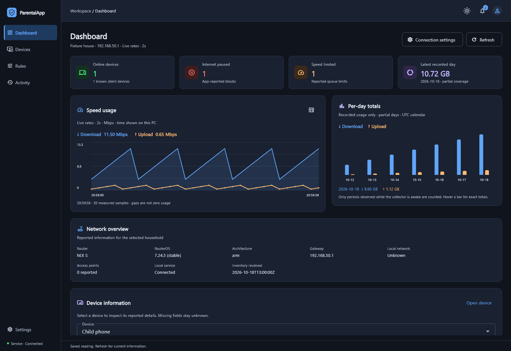
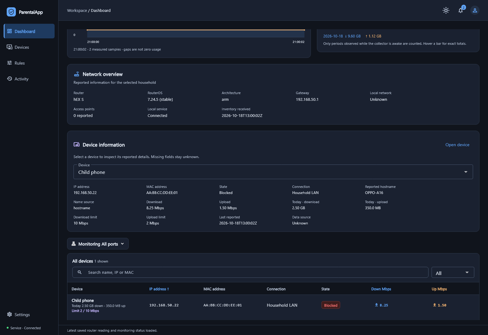
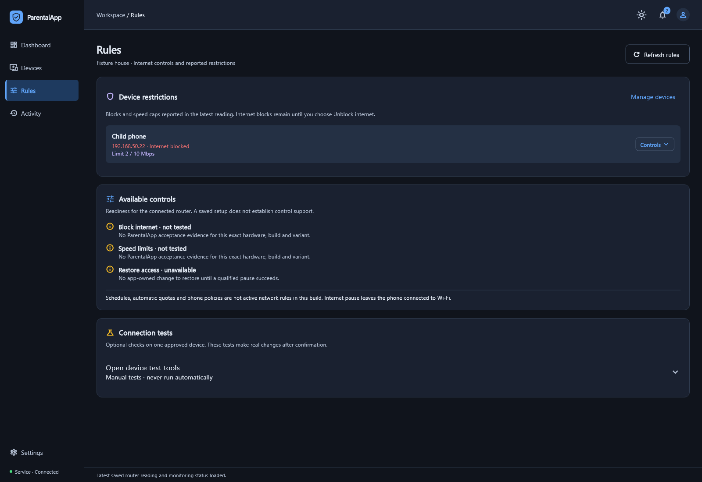
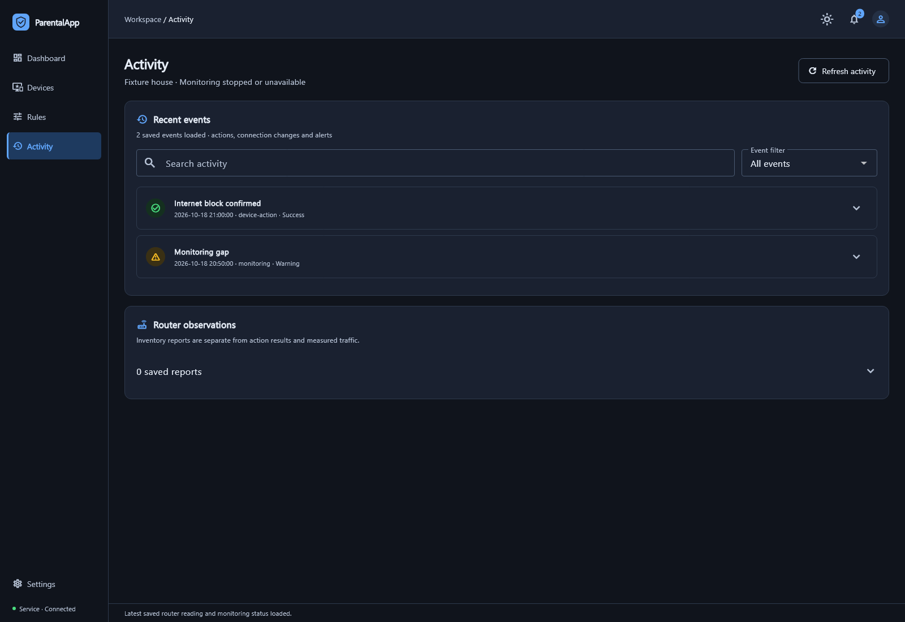

<p align="center">
  
</p>

# ParentalApp

**A native Windows app for household network monitoring and individual device internet controls through MikroTik.**

ParentalApp brings device inventory, measured traffic, usage charts, internet blocking and separate download/upload limits into one desktop workspace. It installs as `ParentalApp.exe` with a local background service through `ParentalApp-Setup.exe`. Client devices do not need additional software for these network controls.

**Status: development preview, version 0.1.0.** The current control target is **MikroTik hEX S running RouterOS 7**. Other RouterOS 7 devices have setup and best-effort monitoring support; their controls remain disabled until qualified. This is not a claim of full support for every MikroTik model or firmware release.

## Dashboard



*Screenshots use simulated data. They illustrate the interface, not hardware compatibility.*

<details>
<summary>View device information, Rules and Activity</summary>







</details>

## Features

| Area | Available in the Windows app |
| --- | --- |
| Dashboard | Online, blocked and speed-limited device counts; measured speed graph; recorded daily download/upload bars |
| Device information | Reported names, separate IP/MAC addresses, status, rates, limits, usage and observation details |
| Internet controls | Block/unblock an individual eligible device on the qualified MikroTik profile |
| Speed limits | Set separate download and upload caps; remove limits afterward |
| Device list | Search, filter, sort, hide a saved row and recover it through Forgotten |
| Rules | Review reported restrictions and available controls; manual test tools are separate |
| Activity | Search saved action results, connection events and alerts; inventory observations appear separately |
| Connection settings | Enroll a household, reconnect to the router, edit the house name and select monitored ports |
| Background service | Continues collection while the desktop window is closed and the Windows PC remains awake |
| Parent access | Password-protected application access and expiring sessions |

Controls depend on router identity, account permissions, client visibility and the approved household scope. A successful login alone does not establish control support.

## Router compatibility

| Router | Current status |
| --- | --- |
| **hEX S (2025 / E60iUGS), RouterOS 7.24.5 stable** | Primary household deployment; blocking/unblocking and speed controls reported working. Full release acceptance remains open. |
| hEX S / RB760iGS running RouterOS 7 | Recognized by the existing control profile; this hardware revision has not been independently tested in the current deployment. |
| Other MikroTik RouterOS 7 devices, including regular hEX, hAP lite, hAP, cAP, RB, CRS, CCR and CHR | Can enroll for identity and available monitoring. Blocking, speed changes and router metadata writes remain unverified and disabled. |
| RouterOS 6 or an unknown/malformed version | No supported control profile. |
| ASUS, TP-Link or another brand as the controlling gateway | Not supported by the active network-control integration. |

**A regular hEX is not automatically equivalent to an hEX S.** Model, firmware, network role and individual features must be checked. Read the [compatibility guide](docs/ROUTER_COMPATIBILITY.md).

## Requirements

- **Windows 11 x64**; installer minimum build 22000. Windows 10 and other architectures are not qualified.
- Administrator approval to install or upgrade the application and Windows service.
- Use the Windows account enrolled during installation.
- A reachable, authorized MikroTik management address on a trusted private IPv4 network.
- The existing RouterOS **`api` service on TCP 8728**, enabled and restricted by the router administrator.
- A RouterOS account with the permissions needed for the requested reads and qualified controls. Hotspot/voucher credentials are different.
- Individually visible clients in the approved household network; downstream equipment should bridge clients in AP mode.
- An awake Windows PC for continuous collection.

The installer includes the application runtimes. End users do not need Flutter, Node.js, Python or developer tools separately. No universal client-count or throughput guarantee has been established.

## Connection security

The current adapter uses **unencrypted RouterOS API on port 8728**. Its connection check confirms reachability, not an SSL/TLS certificate or cryptographic router identity. Restrict management access to the trusted parent PC/network. **Do not expose this service to the public internet.** Production TLS/secure-transport qualification remains pending. See [MikroTik's API manual](https://manual.mikrotik.com/docs/developer-guides/api/).

## Installation and setup

1. Obtain `ParentalApp-Setup.exe` from a release published by the project owner, when available. Check its checksum and signing information.
2. Run setup, approve the Windows administrator prompt and finish installation.
3. Open ParentalApp from the Start menu using the enrolled Windows account.
4. Create the app's parent password or sign in to an existing account.
5. Enter a house name, the actual MikroTik management address and household LAN range. `192.168.88.1` with `192.168.88.0/24` is an example, not a required address.
6. Check the API connection, then enter the RouterOS credentials locally in the app.
7. Read the router and review its returned model, firmware, available reads and control status.
8. Start monitoring. Use **Devices → Controls** for available actions.

Setup does not create an API service, upgrade firmware, reset the router or automatically change its router/AP mode.

Current installers use a **local development signing certificate**, not a public publisher certificate. A build that runs on the development PC may be blocked on another PC. Public distribution and clean-machine acceptance are not complete. Do not disable Windows security protections to run a blocked build.

## Network layout

```text
Internet / ISP
    |
MikroTik hEX S — RouterOS 7 gateway
    |
Isolated, approved household LAN
    |
ASUS / TP-Link / other access points in bridge/AP mode
    |
Individually visible client devices
```

ASUS and TP-Link can provide Wi-Fi as passive APs; this app does not administer them. A client hidden behind another router's NAT cannot be treated as an individually visible device. A whole-branch restriction must never substitute for one-device control.

Shared ISP, Starlink, PisoWiFi, hotspot/voucher and unrelated configuration are outside the intended managed household scope. A different subnet alone does not prove isolation.

## What an internet block does

An internet block restricts the selected client's routed internet traffic through the managed MikroTik. **The device can remain connected to Wi-Fi.** It does not turn off the device, erase its Wi-Fi password, delete its DHCP lease or disconnect it from an ASUS/TP-Link radio. Cellular data and other networks are outside this control path.

Manual blocks remain until removed. Removing a ParentalApp restriction does not remove restrictions configured by another administrator or service.

## Known limitations

- Other RouterOS 7 models do not inherit the hEX S control profile just because monitoring works.
- Full IPv6, FastTrack, recovery, performance and long-running release acceptance remain open.
- Speed requires measured counters. Missing samples appear as unavailable data or gaps.
- Household daily totals use a **UTC calendar**; per-device Today values use the collector PC's local calendar. Totals cover recorded periods, not complete ISP billing usage.
- Collection stops while the Windows host sleeps or is offline. Existing router rules can remain active.
- Wi-Fi disconnection, AP administration, router-management isolation, automated schedules/quotas and secure remote-house operation are not completed product features.
- Device names depend on router-reported information. Full model/owner identification is not guaranteed.

## Documentation

- [Windows app guide](docs/WINDOWS_APP_GUIDE.md): screens, controls, setup, troubleshooting and developer builds.
- [Router compatibility](docs/ROUTER_COMPATIBILITY.md): setup/monitoring versus qualified controls.
- [GitHub publishing notes](docs/GITHUB_PUBLISHING.md): repository description, release wording and publication preparation.

## Verification

Recent Windows work passed **76 controller tests and 40 Flutter tests**, with a clean analyzer. The adapter suite previously passed **35 Python tests**. The latest notification cleanup passed its **9 targeted controller and 5 desktop checks**. Native/staged builds and installation checks passed on the development PC; **82 installed files and 52 icon glyphs** were verified.

These scoped results do not certify every model, establish clean-machine installation or complete the release pilot. Development evidence is retained under `docs/test-evidence/`.

## License and notices

A project-wide `LICENSE` file has not yet been supplied. Third-party components retain their own licenses and notices, including the vendored RouterOS API library. See [Windows component notices](licenses/WINDOWS_COMPONENTS.md) and the notices bundled with the application. No affiliation with or endorsement by MikroTik, ASUS or TP-Link is implied.
